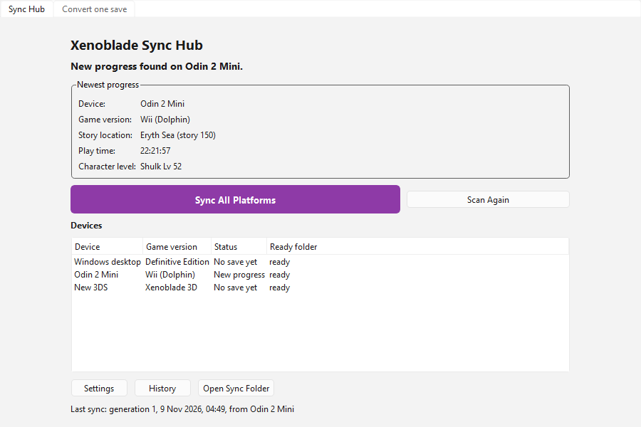
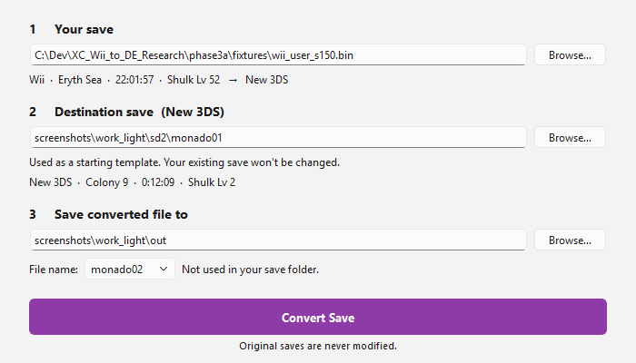
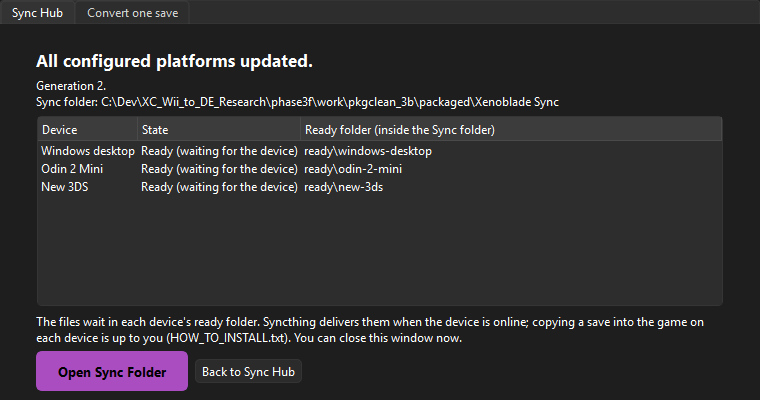

# XC Save Converter and Xenoblade Sync Hub

Carry one *Xenoblade Chronicles* playthrough between three versions of the game:

- **Wii**: *Xenoblade Chronicles* (SX4E). `monado01`–`03` saves, played in Dolphin.
- **Definitive Edition (DE)**: save format v10 (`bfsgame00.sav` and others).
- **New Nintendo 3DS**: *Xenoblade Chronicles 3D* (USA v1.0). `monado0N` saves, played in Azahar or exported from
  a real console with Checkpoint.

The converter rebuilds story progress, party, characters, equipment, inventory, skills, affinity and quests on the
other platform. It keeps DE-only data in a **conversion record**, so a save can travel Wii → DE → 3DS → DE and come
back without losses. The **Sync Hub** builds on it: it scans the save folders of all your devices, finds the newest
progress and prepares an up-to-date save for each device.



## Status

**Release candidate 3F-rc1. Experimental and emulator-tested.** All six directions have been run on real saves in
emulators, and most have been played after conversion. Nothing has been tested on real consoles. Keep backups of
your saves.

| Direction | Status | What was checked |
|---|---|---|
| Wii → DE | Validated | Loaded and played in the DE; story 150–156 continued |
| DE → Wii | Partially validated | Loads, plays and saves in Dolphin; no Wii story event was played after an export |
| Wii → 3DS | Validated | 22-hour save: menus, party, gear, skill trees, quests, combat, travel, in-game save, cold reload |
| 3DS → Wii | Validated | 3DS-played save loads, saves and reloads in Dolphin; byte-exact round trip |
| DE → 3DS | Partially validated | Load, party, stats, equipment and in-game save on the 3DS; combat and travel there not yet covered |
| 3DS → DE | Validated | 3DS-played save loads and saves in the DE; byte-exact round trip |

"Validated" means the converted save was loaded and played (menus, combat or travel, an in-game save and a reload)
with no loss. Details: [THREE_WAY_COMPATIBILITY.md](THREE_WAY_COMPATIBILITY.md),
[GAMEPLAY_COMPATIBILITY_MATRIX.md](GAMEPLAY_COMPATIBILITY_MATRIX.md),
[STORY_PROGRESSION_TESTS.md](STORY_PROGRESSION_TESTS.md).

## Download

`XCSaveConverter-3F-rc1-win-x64.zip` is on the [Releases page](../../releases). It's a portable Windows 10/11 x64
folder and needs no installation or Python:

- `XCSaveConverter.exe` is the desktop app, with a **Sync Hub** tab and a **Convert one save** tab.
- `xcconv.exe` is the converter on the command line.
- `xcsync.exe` is the Sync Hub on the command line.

**One-time game-data setup, inside the app.** The converter needs game tables taken from your own copies of the games. On first start, click **Set up game data…** and point it at your extracted Wii game files (the `files` folder, for example from Dolphin's *Extract Entire Disc*) and your Definitive Edition romfs dump. The app builds the tables itself; no Python or other tools are needed. The tables are game data, so they aren't included in the download.

## Features

- **Six conversion directions** with exact identifiers between the Wii and the 3DS, which share one save layout. The
  DE ⇄ Wii/3DS directions use a measured flag map between the two story-flag spaces.
- **Canonical state model** (`xc1-canon/2`, [`tools/canon.py`](tools/canon.py)). Every save is decoded into one
  platform-neutral description: story scenario, story/quest/event flags, party, characters, arts, skills, links,
  affinity, inventory, gems, collectopaedia, money and play time. Conversions are checked by comparing canonical
  states before and after.
- **Sidecars and conversion records.** Wii ⇄ DE uses a sidecar (`xc1-sidecar/1`) that keeps DE-only state (Expert
  Mode, cosmetics, DE-only items and flags, link-unlock indexes) while the playthrough is on the Wii. Directions
  that involve the 3DS use **conversion records** (`xc1-record/3`). A record embeds that sidecar and carries it
  across any number of Wii ⇄ 3DS hops. It also holds lineage (playthrough id, generation, parent session), snapshots
  for recovery and an integrity hash, so a changed or damaged record is refused. See
  [SIDECAR_V3_DESIGN.md](SIDECAR_V3_DESIGN.md).
- **Character and inventory preservation.** All main and guest records are covered, including Fiora's later form
  (character 8, from 3D on) and the game's stored-equipment table during story separations (3E/3F). Free pocket
  space is reserved so the game can return the stored gear at the reunion. Values that can't be represented are
  refused, never clamped silently.
- **Story progression.** Scenario and flags are converted so the destination game continues the story. Played after
  conversion so far: DE 156 → 158 → 160 and 232 → 233, Wii 154 → 156, 3DS 154 → 156, and the Fiora reunion 288 → 291
  on the DE and the 3DS.
- **Safety.** Inputs, game folders, emulator folders and SD cards are never written. Every run writes one new output
  folder that is either complete or absent. Sync Hub generations can be listed and rolled back.

## Using it

**Desktop app.** Start `XCSaveConverter.exe`.

- *Convert one save*: (1) choose your save, (2) choose a destination save of the other platform. It is only read,
  and serves as the template or base. (3) Choose where the new file goes, then **Convert Save**. Copy the result
  into the game yourself after making a backup. Guide: [GUI_USER_GUIDE.md](GUI_USER_GUIDE.md).
- *Sync Hub*: set up a Sync folder and your devices once, which takes about ten minutes. After that the routine is
  Open → **Sync All Platforms** → Close. New saves wait in a per-device `ready\` folder, which a file-sync tool such
  as Syncthing can deliver. Guide: [SYNC_HUB_USER_GUIDE.md](SYNC_HUB_USER_GUIDE.md).

| Wii → 3DS, ready to convert | Sync complete (dark theme) |
|---|---|
|  |  |

**Command line** (`xcconv.exe <command> --help` shows each command's options):

```
xcconv inspect <save>
xcconv wii-to-de --wii monado01 --template bfsgame00.sav --out <new folder> --slot 01
xcconv de-to-wii --de bfsgame01.sav --sidecar wii_to_de.sidecar.json --current-wii monado01 --out <new folder>
xcconv wii-to-3ds | 3ds-to-wii | de-to-3ds | 3ds-to-de ...
xcsync init | device-add | scan | sync | publish | history | rollback
```

`--dry-run` converts and verifies without writing anything. The exit codes are 0 done, 1 check failed, 2 refused
(nothing written) and 3 internal error (nothing written).

## Known limitations

From [KNOWN_LIMITATIONS.md](KNOWN_LIMITATIONS.md) and [SYNC_KNOWN_LIMITATIONS.md](SYNC_KNOWN_LIMITATIONS.md):

- **No real-hardware testing.** Real New 3DS and Android devices are untested.
- **Story coverage is a sample.** The Mechonis and endgame chapters, *Future Connected* and quest-gated steps have not
  been played after conversion.
- **Wii reunion not played.** The Wii game did not play the 288 → 291 reunion. The DE and the 3DS did.
- **Partially validated directions.** DE → Wii and DE → 3DS are partially validated, as shown in the table above.
- **Re-convert old Fallen Arm saves.** Saves converted by 3E during a Fallen Arm split should be re-converted with 3F
  before you play the reunion on the Wii or 3DS.
- **Refused by design.** Format-v7 DE saves must first be re-saved in DE 2.0. Only the game versions named at the top
  were tested (Wii SX4E, 3DS USA v1.0).
- **Platform behaviour differs.** For example, the DE recomputes some skill-link unlocks. The converter carries over
  whatever the game wrote.

## Building from source

Requirements: Python 3.11+ (3.14 was used), with PySide6 for the GUI and PyInstaller for packaging. The converter
engine itself needs no extra packages.

```
python phase3f/gui/xcconv_gui.py                 # desktop app
python phase3a/src/xcconv3.py --help             # converter CLI
python phase3b/src/xcsync_cli.py --help          # Sync Hub CLI
python -m PyInstaller --noconfirm --workpath build --distpath dist phase3f/gui/xcsaveconverter.spec
```

Most tests need your own saves and tables under the phase `fixtures/` folders. These aren't in the repository.

## Repository layout

The repository mirrors the research folder. Each phase added code beside the previous one, and the phase reports
(`XC_WII_TO_DE_PHASE2*.md`, `XC_*_PHASE3*.md`, `PHASE3*_SUMMARY.md`) document each step.

```
tools/            engine: Wii/DE formats, canonical model, flag map, item correspondence, sidecars, stored gear
phase3a/src/      3DS format (QuickLZ, CTR container), transcoder, conversion records, xcconv3 CLI
phase3b/src/      Sync Hub (xcsync): store, scan, sync, publish, history
phase3f/gui/      current desktop app and PyInstaller spec (earlier phase*/gui folders are kept as they were)
phase*/tests      tests for each phase; phase*/scripts and routes are emulator automation for gameplay validation
specs/            save layouts and Wii → DE rules
```

## Credits

The DE save offsets were implemented from public descriptions (hashcade/xbde-save-editor documentation and
hanyu1774's PartyMember.cs), then re-verified. QuickLZ 1.5 level 3 is an independent implementation from the format
description. Dolphin, Azahar and Syncthing are used as external tools only.

## License

No license has been chosen; all rights are reserved by the author. The Windows package bundles the Python runtime
(PSF license), Qt 6/PySide6 (LGPLv3, dynamically linked) and the PyInstaller bootloader (GPL with the bootloader
exception). No game executables, ROMs, keys, game tables or saves are included.
*Xenoblade Chronicles* is a trademark of Nintendo and Monolith Soft. This project isn't affiliated with them.
